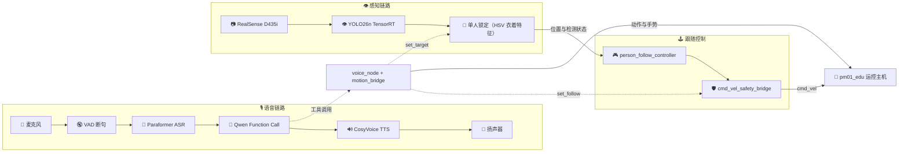

<div align="center">

# PM01 人形机器人统一工作区 🤖

**🎙️ 语音交互 · 👁️ 人员感知 · 🎯 单人锁定跟随 · 🕹️ 运控启动**

一套可构建、可部署、可一键启动的 PM01-EDU ROS 2 工作区

[](https://docs.ros.org/en/humble/)
[](https://www.python.org/)
[](https://www.nvidia.com/en-us/autonomous-machines/embedded-systems/)
[](./README.md#license)
[](./README.md)
[](src/voice_interaction/docs/技术文档.md)
[](src/yolo_person_3d/test/test_target_lock.py)
[](https://github.com/DXSDXS866/pm01_ws/pulls)

</div>

---

> [!WARNING]
> 本仓库会驱动真实机器人。首次运行前请完整阅读[安全须知](#safety)，确保机器人有支撑、周围清空、急停可用。

<p align="center">
  <a href="#sec-intro">🚀 简介</a> ·
  <a href="#sec-features">✨ 能力</a> ·
  <a href="#sec-architecture">🧠 架构</a> ·
  <a href="#sec-quickstart">⚡ 快速开始</a> ·
  <a href="#sec-modes">🎮 运行</a> ·
  <a href="#sec-interfaces">🔌 接口</a> ·
  <a href="#sec-commands">🗣️ 指令</a> ·
  <a href="#safety">⚠️ 安全</a> ·
  <a href="#sec-troubleshooting">🩺 排障</a>
</p>

<a id="sec-intro"></a>

## 🚀 项目简介

PM01 人形机器人把语音交互、视觉感知和运动控制分散在多个 ROS 工作区里，部署和排查成本很高。本仓库将它们收敛到同一套 colcon 工作区：

- **👂 听得见**：唤醒词 → VAD 断句 → 云端 ASR → Qwen 意图理解 → CosyVoice 语音合成
- **👀 看得见**：RealSense D435i + YOLO26n（TensorRT）完成人员检测与 3D 定位
- **🎯 跟得稳**：单人锁定跟随，锁定后不换人；目标遮挡或出画立即停车等待
- **🛡️ 控得住**：跟随速度经过独立安全桥门控，`/vision_follow/cmd_vel` 不会直接驱动运控
- **⚡ 起得快**：`start_all.sh` 一次拉起运控、感知、跟随和语音

> [!TIP]
> **最快上手**：`git clone https://github.com/DXSDXS866/pm01_ws.git ~/pm01_ws && cd ~/pm01_ws && ./build.sh && source ./env.sh && ./run_voice.sh`

<a id="sec-features"></a>

## ✨ 核心能力

| 能力 | 说明 |
|---|---|
| 🎙️ 语音交互 | 唤醒词、能量 VAD、Paraformer 流式 ASR、Qwen function call、流式 TTS |
| 🎯 单人锁定跟随 | 说“跟着我”锁定正前方的人，用躯干 HSV 衣着特征维持身份；旁人不抢目标 |
| 🛑 丢失即停 | 目标被遮挡、走出画面或身份歧义时，感知发 `/person/detected=false`，控制器一帧内停车 |
| 📷 人员 3D 定位 | TensorRT + pycuda 推理，输出相机/机器人坐标系下的人员位置 |
| 🛡️ 安全速度桥 | armed、运动状态、消息新鲜度三重门控，最终才转发 `/cmd_vel` |
| 🕹️ 运控管理 | 远程停止原厂 `pm_v2`、启动 `pm01_edu`，按状态机逐级切到 `walk` |
| 🚀 一键启动 | 运控 → 相机 + YOLO → 跟随控制 → 语音，统一日志目录 |

<a id="sec-architecture"></a>

## 🧠 系统架构



**设计原则**

1. **🛡️ 安全优先**：跟随控制器的速度只进入 `/vision_follow/cmd_vel`，必须经过安全桥才可能到达 `/cmd_vel`。
2. **🎯 身份与位置分离**：单人锁定只负责“这一帧选哪个框”，位置滤波继续使用 EMA + 跳变抑制。
3. **🛑 宁可停车，也不猜人**：多个候选无法区分时进入 `LOST`，不切换到置信度更高的人。
4. **📦 单一环境入口**：所有脚本统一 `source env.sh`，避免旧工作区污染 `AMENT_PREFIX_PATH`。

<a id="sec-structure"></a>

## 📁 仓库结构

```text
.
├── src/
│   ├── interface_protocol/              # PM01 消息与服务定义
│   ├── voice_interaction/               # 语音交互、LLM 工具调用、动作桥
│   │   ├── config/params.yaml           # VAD / ASR / LLM / TTS 参数
│   │   ├── docs/技术文档.md             # 语音链路实现细节
│   │   ├── voice_interaction/
│   │   │   ├── voice_node.py            # 语音主状态机
│   │   │   ├── motion_bridge.py         # ROS 动作桥
│   │   │   ├── asr_client.py            # Paraformer 流式 ASR
│   │   │   ├── tts_client.py            # CosyVoice 流式 TTS
│   │   │   └── media/                   # 本地提示音（可选）
│   │   └── README.md
│   ├── pm01_camera_bringup/             # RealSense 启动
│   ├── yolo_person_3d/                  # 检测 + 单人锁定 + 3D 定位
│   │   ├── yolo_person_3d/
│   │   │   ├── person_3d_node.py
│   │   │   └── target_lock.py           # 纯逻辑身份锁定
│   │   ├── test/test_target_lock.py     # 12 项纯逻辑自测
│   │   └── weights/                     # yolo26n 模型权重
│   └── pm01_aruco_detection/            # 跟随控制 + 安全桥 + 手柄桥
├── tools/
│   └── fake_person_pub.py               # 隔离域冒烟测试：模拟人员位置
├── build.sh                             # 干净环境构建
├── env.sh                               # 唯一环境入口
├── run_voice.sh                         # 只启动语音
├── start_all.sh                         # 运控 + 感知 + 跟随 + 语音一键启动
├── motion_up.sh                         # 远程启动/切换运控状态
├── motion_163.sh                        # systemd 方式管理远端运控（备用）
└── 技术文档-单人锁定跟随.md              # 锁定状态机、算法与接口契约
```

<a id="sec-requirements"></a>

## 🛠️ 环境要求

### 🧰 硬件

- PM01 人形机器人，代码运行在机器人计算单元（Jetson Orin）上
- Intel RealSense D435i（USB 3.0）
- 麦克风 + 扬声器
- 运控主机与计算单元在同一局域网，可 SSH 互通

### 💻 软件

| 依赖 | 说明 |
|---|---|
| Ubuntu 22.04 + ROS 2 Humble | 基础环境 |
| `realsense2_camera` | RealSense ROS 2 驱动 |
| Python 3.10 | 与 Humble 匹配 |
| NumPy < 2 | **必须**，否则 `cv_bridge` 会因 ABI 不匹配崩溃 |
| TensorRT + pycuda | YOLO `.engine` 推理；桌面版 PyTorch 在 Orin 上没有 `sm_87`，不能走 ultralytics 后端 |
| CycloneDDS | `RMW_IMPLEMENTATION=rmw_cyclonedds_cpp` |
| OpenCV | 人员锁定、ArUco 检测与图像处理 |
| `dashscope` | 阿里云 ASR / LLM / CosyVoice TTS |
| `pyaudio`、`sounddevice` | 录音与音频设备枚举 |
| `mpg123` | 流式 TTS 首包即播（缺失时自动回退） |
| `ffmpeg`、`alsa-utils` | 整段 TTS 回退播放 |
| `DASHSCOPE_API_KEY` | 语音链路必需，由运行环境提供 |

```bash
sudo apt install ros-humble-realsense2-camera \
                 python3-opencv python3-numpy python3-pyaudio \
                 mpg123 ffmpeg alsa-utils
pip3 install 'numpy<2' dashscope sounddevice pycuda
```

<a id="sec-quickstart"></a>

## ⚡ 快速开始

### 1️⃣ 克隆与构建

```bash
git clone https://github.com/DXSDXS866/pm01_ws.git ~/pm01_ws
cd ~/pm01_ws
./build.sh
```

`build.sh` 会在干净环境（`env -i` + 只 source `/opt/ros/humble`）中重新执行自身，并使用 `--symlink-install` 构建。构建结束会打印 `install/setup.bash` 的 prefix chain，确认只包含 `/opt/ros/humble` 与本工作区。

增量构建：

```bash
./build.sh --packages-select yolo_person_3d
```

### 2️⃣ 加载环境

```bash
source ./env.sh
```

`env.sh` 会清理旧工作区前缀，source ROS 2 Humble 与厂商包，最后加载本工作区；同时设置 `ROS_DOMAIN_ID`、CycloneDDS 和网卡绑定。新终端只需执行这一条。

### 3️⃣ 配置密钥

```bash
export DASHSCOPE_API_KEY='...'
```

建议写入 `~/.bashrc`，不要提交到仓库。没有密钥时感知与跟随仍可工作，但语音链路不可用。

### 4️⃣ 启动

> [!NOTE]
> 首次验证建议只启动语音，确认 ASR / LLM / TTS 正常后再启动完整链路。

```bash
./run_voice.sh
```

完整链路（会操作真机运控，请先阅读[安全须知](#safety)）：

```bash
./start_all.sh
```

<a id="sec-modes"></a>

## 🎮 运行模式

| 模式 | 命令 | 说明 |
|---|---|---|
| 完整链路 | `./start_all.sh` | 运控 + 相机 + YOLO + 跟随 + 语音 |
| 只启动语音 | `./run_voice.sh` | 适合先验证 ASR / LLM / TTS |
| 只启动感知 | `ros2 launch yolo_person_3d bringup.launch.py` | 相机 + YOLO + 单人锁定 |
| 只启动跟随 | `ros2 launch pm01_aruco_detection person_follow.launch.py armed:=true` | 需运控已处于 `walk` |
| 只管理运控 | `./motion_up.sh` | 交互式启动/切换运控并校验 `/cmd_vel` |

常用选项：

```bash
./start_all.sh -y              # 跳过交互确认（后台/脚本）
./start_all.sh --no-motion     # 不启动运控，只校验现有 walk
./start_all.sh --motion-only   # 只启动运控并切到 walk

./motion_up.sh --check         # 只检查是否处于 walk + /cmd_vel 订阅者
./motion_up.sh --dry-run       # 只打印步骤，不连运控主机
```

后台运行：

```bash
mkdir -p /tmp/pm01_follow_voice
read -rsp '运控主机 sudo 密码: ' PM01_163_SUDO_PASSWORD; echo
export PM01_163_SUDO_PASSWORD
nohup ./start_all.sh -y > /tmp/pm01_follow_voice/start.log 2>&1 &
```

日志：`/tmp/pm01_follow_voice/{motion,vision,follow,voice}.log`。

> 仅在需要重启 `pm01_edu` 时才会提示 sudo 密码；如果运控已在运行，脚本会直接复用。密码只放在当前进程环境里，不要写进脚本或仓库。

<a id="sec-config"></a>

## ⚙️ 配置

### 🌐 环境变量

| 变量 | 默认值 | 作用 |
|---|---|---|
| `PM01_WS` | `~/pm01_ws` | 工作区路径，`env.sh` 使用 |
| `ROS_DOMAIN_ID` | `69` | ROS 域；真机固定，勿与其它节点混用 |
| `RMW_IMPLEMENTATION` | `rmw_cyclonedds_cpp` | DDS 实现 |
| `CYCLONEDDS_URI` | 绑定计算单元网卡 | 换网段时修改 `env.sh` |
| `DASHSCOPE_API_KEY` | 无 | 语音 ASR / LLM / TTS 密钥 |
| `PM01_163_HOST` | `user@192.168.0.163` | 运控主机 SSH 目标 |
| `PM01_163_SDK_DIR` | `/home/user/projects/engineai_robotics` | 运控 SDK 目录 |
| `PM01_163_PROFILE` | `pm01_edu` | 运控配置名 |
| `PM01_163_LOG` | `/tmp/engineai_<profile>.log` | 远端日志路径 |
| `PM01_163_SUDO_PASSWORD` | 无（交互提示） | 非交互运行时的 sudo 密码 |
| `PM01_MOTION_HOST` | `user@192.168.0.163` | `motion_163.sh` 的 SSH 目标 |
| `PM01_MOTION_DIR` | `/home/user/projects/engineai_robotics` | `motion_163.sh` 的 SDK 目录 |
| `PM01_MOTION_UNIT` | `pm01-edu` | `motion_163.sh` 的 systemd 单元名 |

> 密码不要写入仓库或脚本。推荐为运控主机的 `user` 配置受限的 `NOPASSWD` sudo。

### 🎙️ 语音参数

`src/voice_interaction/config/params.yaml`：

```yaml
/**:
  ros__parameters:
    energy_threshold: 500   # VAD 能量阈值（按现场噪声调）
    silence_ms: 450         # 句尾静音判定（400~500 响应快）
    mic_device_index: -1    # -1=系统默认；用 python3 -m sounddevice 查看
    llm_model: qwen-flash   # 低延迟；复杂问答可换 qwen-plus / qwen-max
    tts_model: cosyvoice-v2 # 换 voice 必须同步换 model
    tts_voice: longshu_v2   # 可选 longxiang_v2 / longxiaochen_v2 等
    tts_streaming: true     # 首包即播（需 mpg123）；false=整段合成后播放
```

### 📷 相机与检测参数

| 模块 | 关键参数 | 默认值 / 说明 |
|---|---|---|
| 相机 | `align_depth` | 已启用，提供对齐深度图 |
| 检测 | `model_path` | 安装后的 `weights/yolo26n.engine` |
| 检测 | `device` | 默认 `cpu`；GPU 推理走 TensorRT + pycuda |
| 检测 | `camera_mount_pitch_deg` | `16.1`，按实际安装角度调整 |
| 跟随 | `desired_distance_m` | `0.8` |
| 跟随 | `max_linear_mps` / `max_angular_rps` | `0.45` / `0.6` |
| 跟随 | `armed` | 默认 `false`；一键启动脚本显式传 `true` |
| 跟随 | `require_lock` | 默认 `true`；未锁定前感知不输出目标 |
| 跟随 | `stop_on_detected_false` | 默认 `true`；目标丢失一帧内停车 |

<a id="sec-interfaces"></a>

## 🔌 接口速查

### 📡 关键话题

| 话题 | 类型 | 方向 | 说明 |
|---|---|---|---|
| `/camera/color/image_raw` | `sensor_msgs/Image` | 相机 → 检测 | 彩色图 |
| `/camera/aligned_depth_to_color/image_raw` | `sensor_msgs/Image` | 相机 → 检测 | 对齐深度 |
| `/person/detected` | `std_msgs/Bool` | 检测 → 跟随 | 是否存在**有效锁定目标** |
| `/person/position_camera` | `geometry_msgs/PointStamped` | 检测 | 相机坐标系位置 |
| `/person/position_robot` | `geometry_msgs/PointStamped` | 检测 → 跟随 | 锁定目标的机器人坐标系位置 |
| `/person/set_target` | `std_msgs/String` | 语音 → 检测 | 锁定命令 `{"action":"lock\|relock\|unlock"}` |
| `/person/status` | `std_msgs/String` | 检测 → 语音 | 锁定状态 JSON（`lock_state/lock_reason/generation`） |
| `/vision_follow/set_follow` | `std_msgs/Bool` | 语音 → 跟随 | 跟随开关（安全桥 arm/disarm） |
| `/vision_follow/status` | `std_msgs/String` | 跟随 | 跟随状态 |
| `/vision_follow/cmd_vel` | `geometry_msgs/Twist` | 跟随 → 安全桥 | 期望速度 |
| `/vision_follow/safety_bridge_status` | `std_msgs/String` | 安全桥 | 放行/拦截原因 |
| `/cmd_vel` | `geometry_msgs/Twist` | 安全桥 → 运控 | 最终速度 |
| `/motion/motion_state` | `interface_protocol/MotionState` | 运控 | 当前状态（原厂 `pm_v2` 发布；`pm01_edu` 不发布，见[运控状态机](#sec-motion)） |
| `/motion/set_motion_state` | `interface_protocol/MotionStateRequest` | → 运控 | 切换状态 |
| `/motion/gesture` | `interface_protocol/MotionGesture`（服务） | 语音 → 运控 | 交警手势 0–8 |

### 🧩 主要服务

| 服务 | 说明 |
|---|---|
| `/motion/gesture` | 执行交警手势，`gesture_id` 0–8 |
| `/motion/enable_motor` | 电机使能（`interface_protocol/EnableMotor`，运控侧提供） |

<a id="sec-commands"></a>

## 🗣️ 语音指令

唤醒词：**“你好小智”**（代码匹配 `你好小.`，同音字也可唤醒）。

| 说法 | 动作 |
|---|---|
| 跟着我 | 锁定正前方的人并开始跟随 |
| 重新锁定 / 重新找我 / 重新跟着我 | 跟随中重新选人（安全指令，不经过 LLM） |
| 停止跟随 / 别跟着我 / 停下 | 解除锁定、关闭跟随并保持站立（安全指令，不经过 LLM） |
| 向前走 / 后退 | `walk`（接口保留；当前提示词要求行走统一用“跟着我”） |
| 站起来 / 趴下 | `switch_motion` |
| 挥挥手 | `wave_hand` |
| 做直行 / 左转弯 / 右转弯 / 停止的交警手势 | `gesture`（0=归位 1=停止 2=直行 3=左转弯 4=左转弯待转 5=右转弯 6=变道 7=减速慢行 8=靠边停车） |

LLM 工具共 7 个：`walk`、`switch_motion`、`wave_hand`、`gesture`、`emergency_stop`、`set_follow`、`relock_target`。直连模式下 `emergency_stop` 会映射到 `set_follow(false)`。

<a id="sec-motion"></a>

## 🚦 运控状态机

```text
idle ──► passive ──► pd_stand ──► walk
                                    │
                          /cmd_vel 才生效
```

- 状态**不能跳级**；`motion_up.sh` 会逐级等待确认。
- 两套配置不要混用：

| 配置 | 服务 | 状态名 | 速度入口 |
|---|---|---|---|
| 原厂 `pm_v2` | `robotics.service` | `rl_basic` | `/motion/body_vel_cmd` |
| 本仓库使用 `pm01_edu` | `run_robot.sh pm01_edu` | `walk` | `/cmd_vel` |

- 跟随链路只对 `pm01_edu` 生效。若状态卡在 `rl_basic`，说明运控主机上跑的还是 `pm_v2`。
- `pm01_edu` 不发布 `/motion/motion_state`，`motion_up.sh` 从远端日志的 `Entered motion [ xxx ]` 读取状态；启动后默认 `idle`。
- 运控侧 `stop_vel_threshold: 0.3`：低于 0.3 的速度指令会被当作“停下”，不要随意调低跟随速度。

<a id="safety"></a>

## ⚠️ 安全须知

- `start_all.sh` 会自动操作真机运控：`passive` 会松关节，`pd_stand` 会站起，`walk` 会进入行走控制。
- 启动前必须确认：机器人已趴下或有支撑、周围清空、急停可用、人离开机器人正前方。
- `armed=true` 只代表安全桥允许转发速度；严格锁定模式下，未说“跟着我”不会有目标，锁定目标丢失会立即停车。
- 第一次验证建议使用 `--no-motion` + 分步启动，或先运行 `motion_up.sh --check`。
- Ctrl+C 只停本机节点；运控主机的 `pm01_edu` 会继续运行，机器人仍在 `walk`。脚本退出时会打印切回 `pd_stand` / 停止 `pm01_edu` / 恢复 `pm_v2` 的命令。
- 真机 `ROS_DOMAIN_ID=69`；不要在机器人旁随意启动会发布 `/cmd_vel` 的节点。
- `numpy` 必须 < 2；不要设置 `PYTHONNOUSERSITE=1`，否则 user-site 里的 pycuda / numpy 会不可见。
- YOLO 使用 TensorRT `.engine` + pycuda，不要切换成 ultralytics 的 TRT 后端。

<a id="sec-testing"></a>

## 🧪 测试

```bash
source ./env.sh
colcon test --base-paths src \
  --packages-select pm01_aruco_detection \
  --event-handlers console_direct+
colcon test-result --verbose
```

单人锁定纯逻辑自测（无需 ROS / 相机）：

```bash
python3 src/yolo_person_3d/test/test_target_lock.py
# ALL 12 TESTS PASSED
```

现有结果：

| 测试 | 结果 |
|---|---|
| `test_target_lock.py` | 12/12 通过 |
| `test_person_follow_control.py` | 5/5 通过 |
| `test_pm01_gamepad_bridge.py` | 4/4 通过 |
| `test_aruco_core.py` | 3 通过 / 3 失败（OpenCV 版本差异，见[已知问题](#known-issues)） |

### 🧯 隔离域冒烟测试（不驱动真机）

在独立 ROS 域、只启动跟随控制器并喂入模拟人员位置：

```bash
source ./env.sh
# env.sh 会设置真机域 69，这里必须覆盖到隔离域
export ROS_DOMAIN_ID=42 ROS_LOCALHOST_ONLY=1
export RMW_IMPLEMENTATION=rmw_fastrtps_cpp
unset CYCLONEDDS_URI

ros2 run pm01_aruco_detection person_follow_controller &
python3 tools/fake_person_pub.py 2.0 0.0
ros2 topic echo --once /vision_follow/cmd_vel
```

<a id="sec-troubleshooting"></a>

## 🩺 故障排查

| 现象 | 排查 |
|---|---|
| `not found: .../install/local_setup.bash` | 旧工作区被 source 进来了。新开终端，只 `source ./env.sh` |
| `ModuleNotFoundError: interface_protocol` | 确认 `install/setup.bash` 存在并最后 source；先运行 `./build.sh` |
| `No module named 'pycuda'` / numpy ABI 错误 | 不要设 `PYTHONNOUSERSITE=1`；确认 `numpy<2` |
| YOLO 找不到 engine | `ls install/yolo_person_3d/share/yolo_person_3d/weights/`，或单独重建该包 |
| 语音没声音 | 确认 `DASHSCOPE_API_KEY`；看 `run_voice.sh` 打印的 import 路径；确认 `mpg123` 已安装 |
| `motion_up.sh` SSH 失败 | 先手动 `ssh user@<运控主机> true`；脚本使用免密 key（`BatchMode=yes`） |
| 提示需要 sudo 密码 | 交互终端会提示；后台用 `PM01_163_SUDO_PASSWORD`，或先手动起 `pm01_edu` 再用 `--no-motion` |
| `pm01_edu` 等不到就绪 | `ssh <运控主机> 'tail -n 60 /tmp/engineai_pm01_edu.log'`，检查日志是否属于当前进程 |
| 状态卡在 `rl_basic` | 运控主机上还是 `pm_v2`；检查 `ps -ef \| grep src_executor` |
| `/cmd_vel` 没有 `ros2_control_node` 订阅者 | `pm01_edu` 未完整启动，或 `pm_v2` 仍在跑；跟随链路无效 |
| 退出脚本后机器人还在 walk | 预期行为；按脚本提示切 `pd_stand` 或停止 `pm01_edu` |
| 跟随中换人 / 被路人带走 | 确认 `require_lock:=true`；`ros2 topic echo /person/status` 看 `lock_state`（`LOST` 时应停车等待） |
| 目标丢失但机器人还在走 | 检查 `stop_on_detected_false`；控制器应在一帧内发 `STOP_TARGET_LOST` |
| 构建失败 | 看 `log/latest_build/<pkg>/stderr.log` |

<a id="known-issues"></a>

## 🐞 已知问题

- `pm01_aruco_detection/test/test_aruco_core.py` 在 OpenCV 5.x 下有 3 个用例失败：
  `IndexError: invalid index to scalar variable`（`aruco_core.py` 对 `ids` 形状的假设与新版 OpenCV 不一致）。
  当前 YOLO 跟随链路不经过 ArUco 检测；修复方式是把该行改为
  `marker_id = int(np.asarray(marker_id_array).reshape(-1)[0])`。
- `yolo_person_3d/weights/` 同时保留 `.onnx` 与 `.pt` 便于重新导出；运行时只需要 `.engine`。

<a id="sec-docs"></a>

## 📚 文档导航

| 文档 | 内容 |
|---|---|
| [README.md](README.md) | 项目总览、构建、运行和故障排查 |
| [技术文档-单人锁定跟随.md](技术文档-单人锁定跟随.md) | 锁定状态机、算法、接口契约、参数调优与验收 |
| [src/voice_interaction/docs/技术文档.md](src/voice_interaction/docs/技术文档.md) | 语音链路线程模型、模块细节与打断机制 |
| [src/voice_interaction/README.md](src/voice_interaction/README.md) | 语音包部署与参数说明 |

<a id="license"></a>

## 📄 许可证

本仓库包含的包分别声明了 MIT / Apache-2.0。厂商 SDK、模型权重与第三方依赖遵循其各自许可证；使用前请确认你有权在目标设备上部署这些组件。
